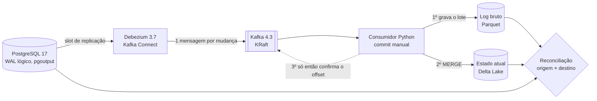

# pg-cdc-lakehouse

[](https://github.com/alanjoffre/pg-cdc-lakehouse/actions/workflows/ci.yml)


[](LICENSE)

Replicação contínua de um PostgreSQL para um lakehouse por **CDC** (*Change Data Capture*):
cada insert, update e delete de linha da origem chega ao destino em segundos, por Debezium e
Apache Kafka (TRUNCATE e mudança de esquema ficam de fora).
O destino guarda o log bruto em Parquet e o estado atual numa tabela Delta Lake.

A pergunta que o projeto responde não é "dá para copiar?", e sim **"como provar que a cópia está
certa depois de uma falha?"**. Por isso o roteiro derruba as peças de propósito, de 3 jeitos (consumidor,
Debezium e mensagens repetidas), e depois de cada cenário, inclusive o de operação normal, confere a
origem contra o destino: contagem, chaves, conteúdo e hash.

---

## Em um minuto

| | |
|---|---|
| **O que é** | PostgreSQL 17 → Debezium 3.7 (Kafka Connect) → Kafka 4.3 em KRaft → consumidor Python → log em Parquet + estado atual em Delta Lake (delta-rs) |
| **Com que dado** | Uma loja fictícia (clientes e pedidos), gerada com semente fixa. Nenhum dado real |
| **Garantia** | Entrega *at-least-once* com **estado final idempotente**: a fila pode repetir; o log guarda a cópia, e o estado atual não muda por isso. Não é *exactly-once* (ver [D1](docs/decisoes.md#d1-entrega-pelo-menos-uma-vez-com-estado-final-idempotente)) |
| **Como se prova** | `python -m cdc.cenarios` sobe o ambiente limpo, injeta as falhas e grava o resultado em [`reports/cenarios.md`](reports/cenarios.md). 20 testes de unidade; o CI roda lint, tipos e testes a cada push, e os cenários sob demanda |
| **O que não é** | Não é benchmark nem ambiente de produção: um broker, uma máquina, dado sintético (ver [Limites declarados](#limites-declarados)) |

**Para avaliar em 10 minutos:** [resultado dos cenários](reports/cenarios.md) →
[registro de decisões](docs/decisoes.md) → [`src/cdc/delta.py`](src/cdc/delta.py) (o MERGE) →
[`src/cdc/consumidor.py`](src/cdc/consumidor.py) (gravar antes de confirmar) → [`tests/`](tests/).

## Resultado

Última execução (semente 42), da [prova completa](reports/cenarios.json). Cada cenário roda sobre
o estado deixado pelo anterior:

| Cenário (falha injetada) | Como foi provocada | Linhas de pedidos, origem × destino | Delta igual à origem | Repetidos descartados na leitura |
|---|---|---|---|---|
| Nenhuma (operação normal) | snapshot inicial + 3.000 mudanças e 80 de casos de borda, com o consumidor rodando | 1.340 × 1.340 | sim | 0 |
| Queda do consumidor | o processo sai com `os._exit(3)` depois de gravar e antes de confirmar o offset | 1.439 × 1.439 | sim | 500 reentregues depois da queda; no Delta, reaplicadas sem mudar o estado |
| Queda do Debezium | `docker compose kill connect` (SIGKILL) com a origem recebendo escrita | 1.614 × 1.614 | sim | 300 |
| Mensagens repetidas | 400 cópias de mensagens já consumidas publicadas de novo, embaralhadas | 1.614 × 1.614 | sim | 400; no Delta, o MERGE recebeu 372 linhas e alterou 0 |

Em todos: clientes 200 × 200, 0 chaves faltando, sobrando ou divergentes, hash SHA-256 igual e
**0 colisões de identidade** (ver [Identidade de cada mudança](#identidade-de-cada-mudança)).
O cenário só passa se a falha também tiver acontecido de fato: o código de saída 3, a reentrega
medida na fonte e os repetidos contados no próprio cenário.

## Arquitetura



## Como a cópia fica certa

Três regras, cada uma com prova: a regra 1 no cenário da queda do consumidor (`os._exit` entre
gravar e confirmar); as regras 2 e 3 em testes de unidade e no cenário das mensagens repetidas,
em que o MERGE recebe as cópias e não altera nenhuma linha.

1. **Gravar antes de confirmar.** O consumidor grava o lote no Parquet, aplica o MERGE no Delta e
   só então confirma o offset no Kafka. Se cair no meio, a fila reentrega o lote: nas falhas
   testadas, nenhuma mudança do tópico deixou de chegar ao destino, e algumas chegaram repetidas.
2. **Cada mudança tem identidade própria: `(tabela, chave, lsn)`.** O LSN é a posição da mudança no
   WAL do PostgreSQL, que o Debezium informa no bloco `source`. No log em Parquet, a leitura fica
   com um evento por identidade e, por chave, o de maior LSN.
3. **O MERGE só avança.** Na tabela Delta:
   - dentro do lote, fica só a mudança mais nova de cada chave;
   - `WHEN MATCHED AND s.lsn > t.lsn THEN UPDATE`: evento repetido ou atrasado não muda a linha;
   - o delete é lógico (`apagado = true`, com o LSN dele), para um evento velho que chegue depois
     não trazer a linha de volta.

### Identidade de cada mudança

O descarte de repetidos só é seguro se duas mudanças diferentes nunca tiverem a mesma identidade.
Isso foi verificado nos casos gerados: o gerador faz, **na mesma transação**, dois updates da mesma linha
(20 vezes) e apaga e reinsere o mesmo id (20 vezes). O relatório conta as colisões, ou seja, a mesma
`(tabela, chave, lsn)` com conteúdo diferente. Deu 0 em todos os cenários. No snapshot inicial,
todas as linhas vêm com o mesmo LSN (o do início do snapshot); a identidade continua única porque
inclui a chave, e qualquer mudança posterior tem LSN maior.

## O que as execuções mostraram

| Achado | Evidência | Onde |
|---|---|---|
| **O consumidor que volta fica parado** | Na 1ª rodada, o consumidor reiniciado depois da queda não recebia partições: o grupo ainda dava o processo morto como dono até a sessão vencer (45 s). Correção: sessão de 10 s e o tempo ocioso contado só depois de receber as partições | [D6](docs/decisoes.md#d6-falhas-injetadas-de-verdade-e-conferidas) |
| **Contagem certa, prova errada** | Na 2ª rodada, origem e destino bateram, mas a prova da queda dava 0 reentregas: a mesma faixa de offsets regravava o mesmo arquivo. A reentrega passou a ser medida na fonte | [`consumidor.py`](src/cdc/consumidor.py) |
| **MERGE sem dedup do lote duplica em silêncio** | Com a regra do dedup retirada de propósito, uma tabela Delta nova recebeu a mesma chave 3 vezes, sem erro | [D9](docs/decisoes.md#d9-estado-atual-em-delta-lake-por-merge-que-só-avança) |
| **A medição da latência pesava mais que o pipeline** | Até a 4ª rodada, o p50 até o Delta dava ~4,1 s, e a medida começava com o consumidor ainda partindo a frio, junto com a carga inicial. Com a medida só depois de o snapshot estar gravado, o consumo com prazo de 0,2 s e sem a espera do 1º rebalance no broker, caiu para 1,6 s. As três mudanças entraram juntas; o efeito de cada uma não foi separado | [`cenarios.py`](src/cdc/cenarios.py) |
| **Contagem igual não prova nada** | Uma linha trocada por outra empata na contagem. Por isso a reconciliação também compara chaves, conteúdo e um hash em forma canônica | [`reconciliar.py`](src/cdc/reconciliar.py) |

## Decisões e o que ficou de fora

O registro completo, com contexto, decisão e consequência, está em [`docs/decisoes.md`](docs/decisoes.md).
Em resumo:

| Ficou de fora | Por quê | Em produção |
|---|---|---|
| *Exactly-once* (KIP-618) | O estado idempotente resolve sem depender de transação no Kafka | Avaliar quando o destino não puder ser idempotente |
| Avro + Schema Registry | Mais um serviço e um cenário de evolução de esquema, que diluiriam a prova | Avro com um Schema Registry (o Apicurio é o registro dos exemplos da documentação do Debezium) |
| DDL pelo CDC | O pgoutput não emite DDL | Procedimento de mudança de esquema à parte |
| Iceberg | O mesmo mecanismo com outro formato de tabela | Escolha da plataforma |
| Spark, Flink | O volume cabe num processo Python; o foco é a garantia, não a escala | Structured Streaming ou Flink conforme o volume |

### No Databricks

O MERGE deste projeto é o que o **Auto CDC** (antigo `APPLY CHANGES INTO`) do Lakeflow Declarative
Pipelines faz de forma declarativa:

```sql
CREATE OR REFRESH STREAMING TABLE pedidos;

CREATE FLOW pedidos_cdc
AS AUTO CDC INTO pedidos
FROM stream(pedidos_bronze)
KEYS (id)
APPLY AS DELETE WHEN op = 'd'
SEQUENCE BY lsn
COLUMNS * EXCEPT (op, lsn)
STORED AS SCD TYPE 1;
```

`SEQUENCE BY lsn` é a regra 3 acima: vale a mudança mais nova, não a última que chegou. Uma
diferença: no SCD tipo 1 do Auto CDC, o delete remove a linha da tabela; aqui o delete é lógico
(`apagado = true`). O exemplo SQL foi conferido na documentação da Databricks, não executado.
O MERGE com SCD tipo 2 roda com dado público (GH Archive) no
[notebook 05 do oss-lakehouse](https://github.com/alanjoffre/oss-lakehouse/blob/main/notebooks/05_bronze_silver_merge_scd2.ipynb).

## Limites declarados

- **Escopo da prova:** as 3 falhas injetadas (mais a operação normal, como controle), com dado sintético, numa máquina, com um broker. Outras
  falhas (perda do slot de replicação, disco cheio, partição de rede, broker com réplicas) não foram
  testadas.
- **Forma dos dados:** duas tabelas com chave primária inteira simples. Chave composta, update da
  chave primária (o Debezium o entrega como delete + insert), TRUNCATE e evolução de esquema não
  foram testados (ver [D4](docs/decisoes.md#d4-sem-tombstone-e-sem-ddl-pelo-cdc)). A linha fica
  guardada como JSON numa coluna de texto, e não em colunas tipadas.
- **Topologia:** um consumidor, uma partição por tópico e um broker. Cada queda foi provocada num
  único ponto (consumidor entre gravar e confirmar; Connect com SIGKILL). Tombstones desligados
  no conector.
- **Repetidos variáveis:** quantos eventos o Debezium republica depois do SIGKILL depende de quando
  ele salvou o último offset: variou de 40 a 840 em 5 execuções (ver
  [`reports/historico/`](reports/historico/)). O que não varia é o resultado: origem igual ao destino.
- **Latência:** da mudança na origem (`source.ts_ms`), no cenário 1, p50 de 0,48 s até o tópico do
  Kafka, 1,4 s até o Parquet e 1,6 s até a tabela Delta (p95 de 2,4 s), medida depois de o
  consumidor gravar o snapshot. Dentro do trecho do tópico ao Parquet (busca, conversão e
  gravação do lote) não houve decomposição. É medida numa máquina com Docker: serve para comparar
  execuções deste projeto, não é benchmark.
- **Pequenos arquivos:** cada lote é um commit no `_delta_log`. Em produção, `optimize` e `vacuum`
  periódicos.
- **Falha que pode não acontecer:** o cenário 3 só passa se o Debezium republicar algo depois
  do SIGKILL. Se ele tiver salvo o offset logo antes da queda, o cenário reprova sem defeito na
  cópia; a regra é de propósito, para não contar como provada uma falha que não houve.
- **Ordem por chave:** ordenar a mesma chave pelo LSN do registro vale porque o PostgreSQL trava a
  linha até o commit. O campo `source.sequence` do Debezium (um par: o último LSN confirmado e o LSN atual) é um
  desempate possível (ver [D2](docs/decisoes.md#d2-identidade-de-cada-mudança-tabela-chave-lsn)).

## Como rodar

Requisitos: Docker com Compose e [uv](https://docs.astral.sh/uv/). O ambiente usa cerca de 2 GB de
memória e as portas 56432 (PostgreSQL), 59094 (Kafka) e 58083 (Kafka Connect). As credenciais do
compose são do ambiente descartável e só existem na máquina local.

```bash
uv sync --extra dev
uv run pytest -q                   # 20 testes de unidade, sem Docker
uv run python -m cdc.cenarios      # 4 cenários (3 falhas e a operação normal) e reconcilia (~6 min)
uv run python -m cdc.relatorio     # regenera reports/cenarios.md a partir do .json
docker compose down -v             # derruba e apaga o ambiente
```

O selo do CI cobre lint, tipos e testes de unidade. Os cenários rodam sob demanda no GitHub
(Actions → ci → *Run workflow*), com o relatório no resumo da execução. A 1ª execução no runner
do GitHub foi aprovada nos 4 cenários
([run de 13/11/2026](https://github.com/alanjoffre/pg-cdc-lakehouse/actions/runs/43485076698)).
As execuções locais anteriores,
inclusive as reprovadas, estão em [`reports/historico/`](reports/historico/).

## Estrutura

```text
src/cdc/
  eventos.py      envelope do Debezium → evento (tabela, chave, op, lsn)
  consumidor.py   Kafka → Parquet + Delta; grava antes de confirmar; --falhar-apos injeta a queda
  destino.py      log bruto em Parquet e o estado atual calculado no DuckDB
  delta.py        estado atual em Delta Lake por MERGE que só avança
  gerador.py      carga sintética e determinística na origem
  reconciliar.py  origem × destino: contagem, chaves, conteúdo e hash
  cenarios.py     o roteiro de ponta a ponta: 4 cenários (3 falhas e a operação normal)
  relatorio.py    reports/cenarios.json → reports/cenarios.md
connector/        configuração do conector Debezium
sql/              esquema da origem (REPLICA IDENTITY FULL e a publicação)
docs/decisoes.md  registro de decisões (D1 a D9)
```

## Autoria

Projeto de portfólio desenvolvido por mim, com apoio de um assistente de IA para código, testes e
documentação; o apoio é visível nos commits. Eu defini o escopo, as decisões de desenho, a execução
dos cenários e as medições, e revisei o resultado.

## Licença

[MIT](LICENSE).
